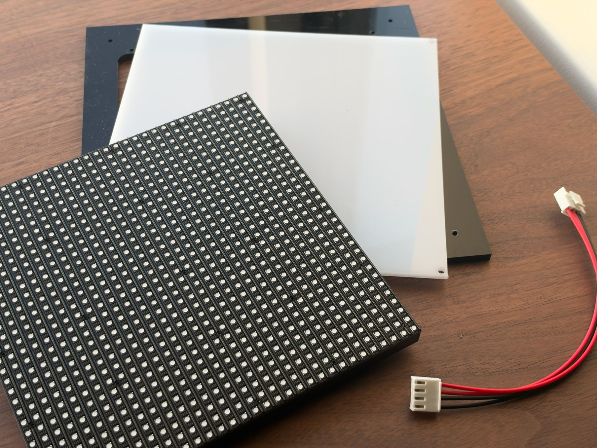
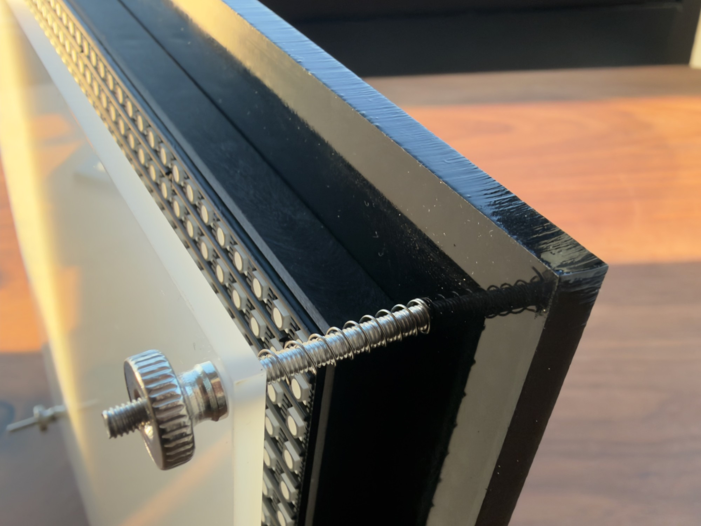
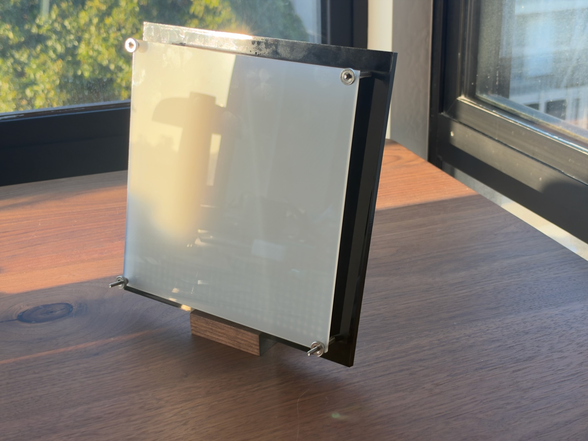
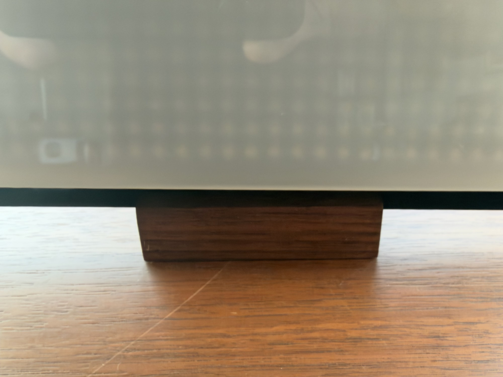

# Bill of Materials — LED Art Panel

Parts for one panel; see the photos in [README.md](./README.md). PCB parts come from `Hardware Files/light_panel.fzz`.
Pin assignments are in [README.md → What you need](./README.md#what-you-need).

## Electronics

| Qty | Ref | Part | Notes |
|----:|-----|------|-------|
| 1 | M1 | ESP32 dev board, **DOIT ESP32 DevKit V1, 30-pin** (ESP32-WROOM-32) | **USB-C version.** Must be the 30-pin layout to fit the PCB. The original ESP32, not S2/S3/C3. USB-C powers both the board and the panel. USB-serial chip is CP210x or CH340 (see the drivers step in the README). |
| 1 | — | **P6 32×32 RGB LED matrix, HUB75**, 1/16 scan (A–D address lines, no E) | 6 mm pixel pitch, so about 192 × 192 mm (7.6″ square). This firmware's pin map assumes HUB75 pin 8 is B1 (see `E_PIN` in `LED_Art_Panel.ino`). |
| 1 | PCB1 | LED Art Panel PCB, 2-layer, 60.9 × 28.7 mm | Gerbers: `Hardware Files/light_panel_gerber.zip`. |
| 1 | J3 | 2×8 female pin header, 2.54 mm (0.1″) pitch, through-hole | HUB75 connector; the panel's ribbon plugs in here. |
| 1 | J2 | 4-pin header, 3.96 mm (0.156″) pitch (VH / Molex KK-156 style), through-hole | Sends 5 V and GND from the ESP32's VIN to the panel's power input. |
| 1 | — | 16-pin HUB75 IDC ribbon cable | Usually comes with the panel. |
| 1 | — | 4-pin power cable | Runs from J2 to the power input on the LED panel. Usually comes with the panel. |
| 1 | — | USB-C cable + 5 V USB power supply | ≥2 A recommended. Powering through USB caps brightness; a full-brightness 32×32 panel can draw 2–4 A. |

**No PCB?** Swap PCB1, J2 and J3 for female–female jumper wires to the HUB75 ribbon
and a separate 5 V supply (≥4 A) for the panel. Connect its ground to the ESP32's GND.

## Enclosure

| Qty | Part | Notes |
|----:|------|-------|
| 1 | Backplate, ¼″ (6 mm) acrylic | |
| 1 | Diffuser, ⅛″ (3 mm) acrylic | Sits in front of the LEDs. |
| 4 | M3 × 0.5 screw, 40 mm long | |
| 4 | M3 screw, 8 mm long | |
| 4 | Compression spring, 0.5 mm wire × 4 mm OD, 30 mm long | Fits over the M3 screws. |
| 4 | Knurled thumb nut, M3 × 0.5, round knob | Hand-tightens on the M3 screws. |

Laser-cut templates: `Hardware Files/10inch_LED_panel_template.ai` and
`Hardware Files/easel_LED_panel_template.ai`.

  
  

<em>Left: panel, diffuser, backplate and power cable. Right: each corner screw has a spring, and a thumb nut holds the diffuser.</em>

### Optional stand

| Qty | Part | Notes |
|----:|------|-------|
| 1 | Wooden block | Cut a ¼″-wide slot into the top at a 10° tilt. The ¼″ backplate stands in the slot. |

  
  

## Tools

- Soldering iron and solder (through-hole headers only)
- Laser cutter for the acrylic; a saw for the stand's slot
- A computer with a USB port, set up with `setup_panel.py` / the `Setup-*` programs
