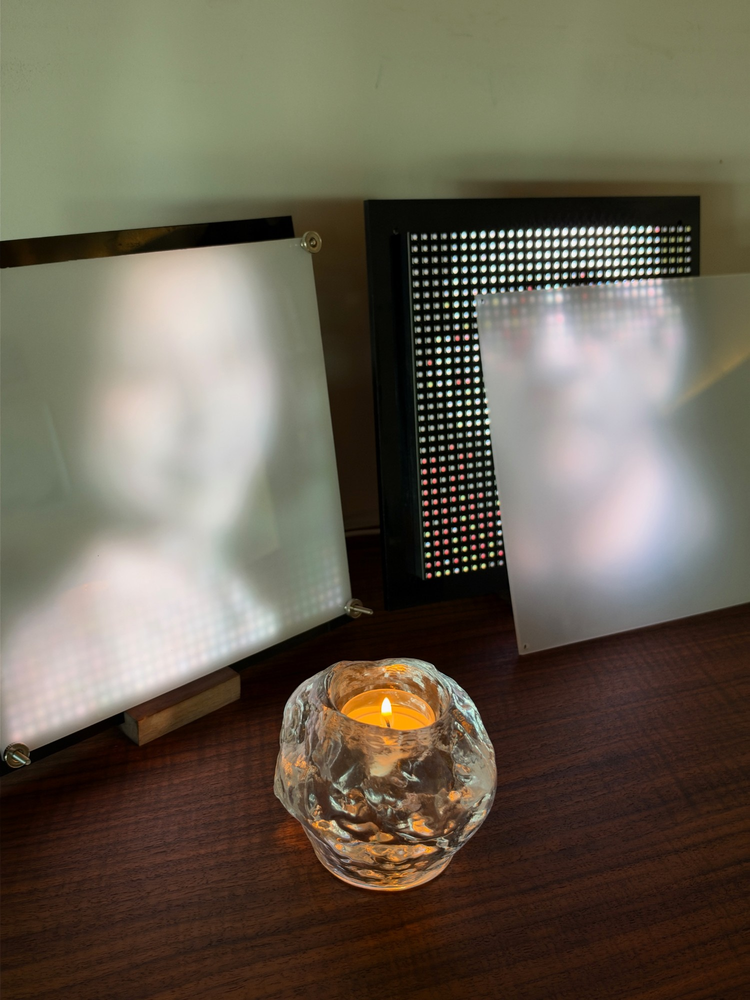
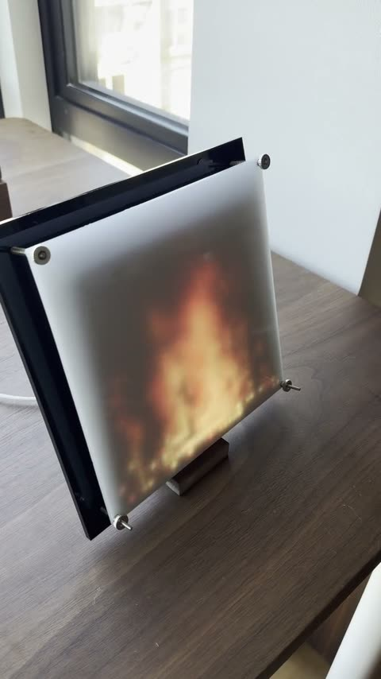
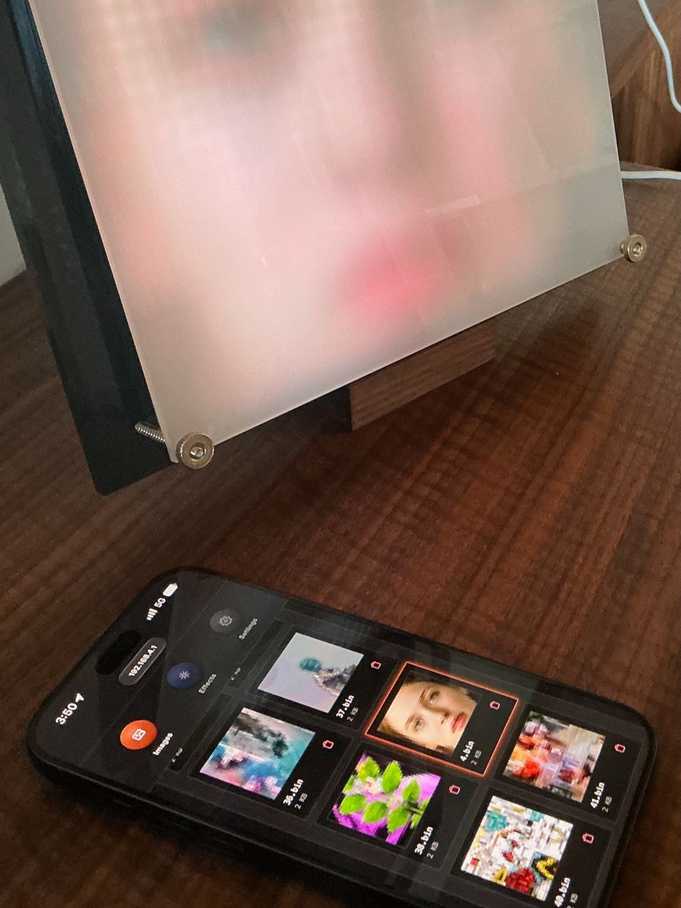
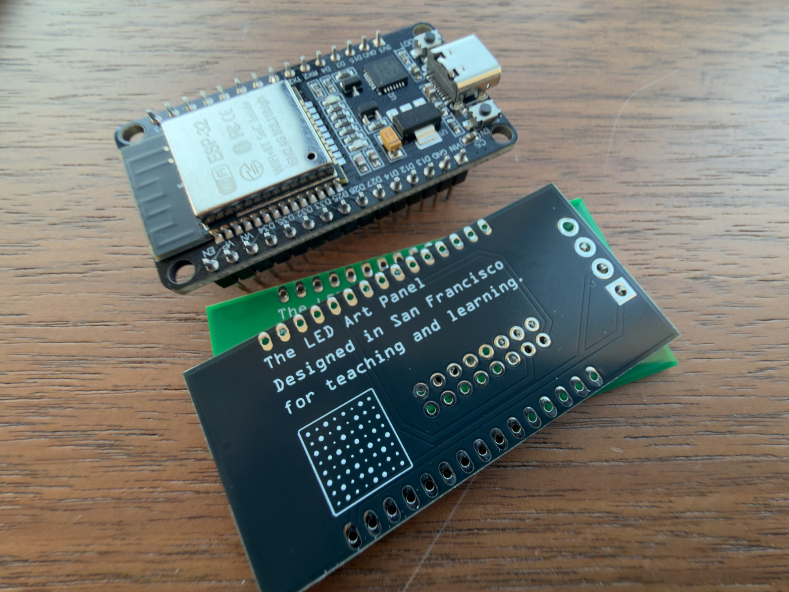
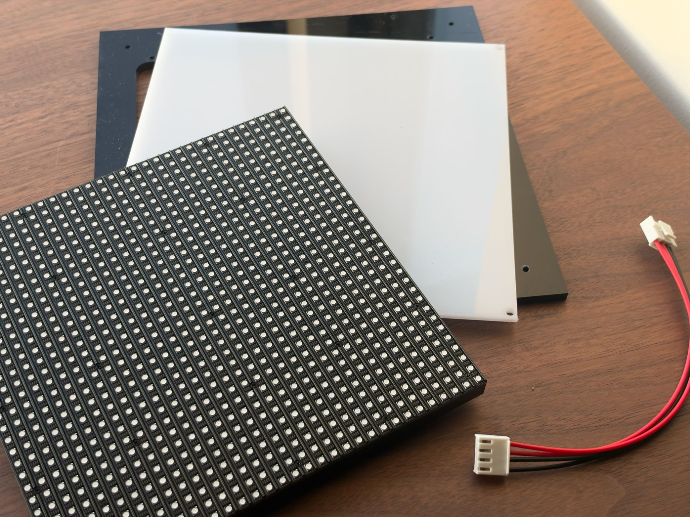
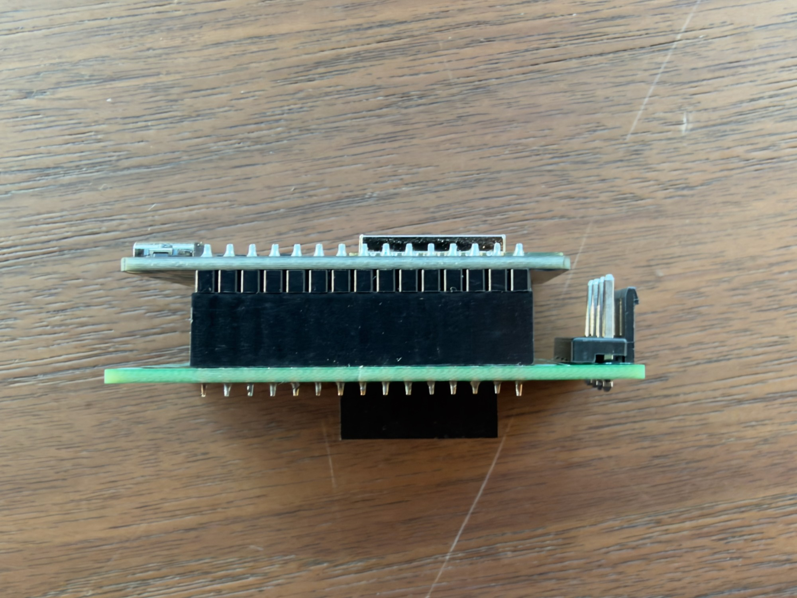
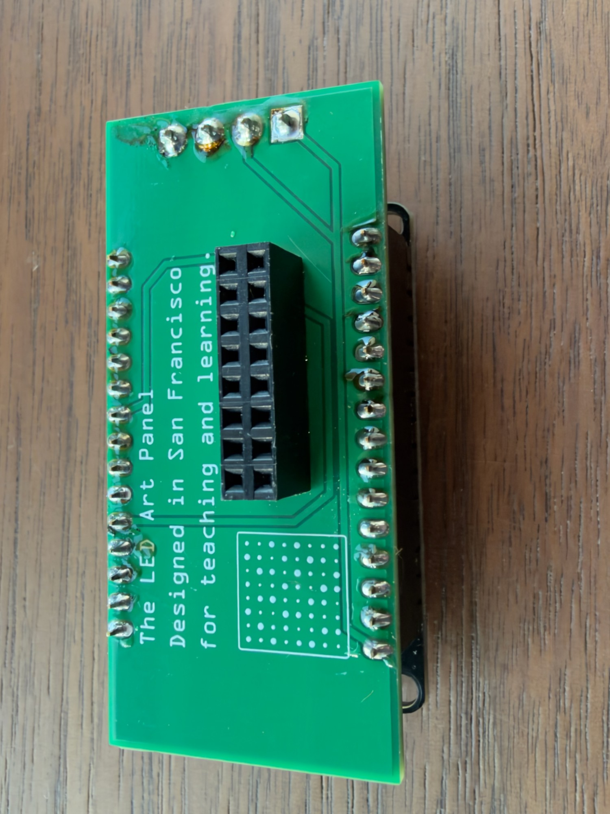

# LED Art Panel

<p align="center">
  
</p>

Inspired by and in homage to the work of San Francisco artist Jim Campbell. The project is an LED based, WiFi-enabled digital display. An **ESP32** microcontroller drives a **32×32 RGB LED matrix** (HUB75) that plays images and animated GIFs uploaded from your phone or computer, or runs generative animated effects. 

Everything is controlled from a small web page hosted on the device itself — no app, no account,
no cloud. 

This README is written to get a **complete beginner** from nothing to a working
panel, and then to help you (or an AI coding assistant) **make it your own** —
with a new look, new effects, new features, or a by creating a completely different LED based project.

> **New here? Read the two sections in order:** [Get started from zero](#get-started-from-zero)
> to build and flash it, then [Make it your own](#make-it-your-own) to change it.

---

## Contents

- [What you'll build](#what-youll-build)
- [What you need](#what-you-need) (full parts list: [BOM.md](./BOM.md))
- [Get started from zero](#get-started-from-zero)
- [How the project is organized](#how-the-project-is-organized)
- [Make it your own](#make-it-your-own)
- [Open source](#open-source)
- [Working with an AI assistant](#working-with-an-ai-assistant)
- [Build & flash reference](#build--flash-reference)
- [Troubleshooting](#troubleshooting)
- [Technical reference](#technical-reference)

---

## What you'll build

When it's running you'll have a small framed LED panel that:

- Plays **images and GIFs** you upload, shuffling through them with smooth
  crossfade or "pixel-dissolve" transitions.
- Runs generative **effects** (fire, an aquatic Game of Life, rain ripples, aurora).
- Hosts its **own web page** for control — reachable either by joining the panel's
  own WiFi hotspot, or over your home network by a friendly name.

You control brightness, timing, effects, and WiFi from that web page.

<p align="center">
  <a href="docs/images/demo.mp4"></a>
  
</p>
<p align="center"><em>Left: the fire effect, then the wiring behind the panel (click to play the video). Right: the control page on a phone.</em></p>

---

## What you need

**Hardware** — the full parts list (with PCB part numbers and enclosure files) is in
**[BOM.md](./BOM.md)**.
- An **ESP32 development board** (the original ESP32, e.g. ESP32-WROOM DevKit).
- A **32×32 HUB75 RGB LED matrix panel**.
- A **5V power supply** sized for the panel (a 32×32 panel can draw up to ~2–4A
  at full brightness — don't try to power the LEDs from the ESP32's USB). If using the LED Art Panel PCB, you *can* power the project with a USB-C cable and power supply.
- The LED Art Panel PCB and connectors. The ESP32 plugs into the PCB, and the PCB
  mounts directly onto the **HUB75 input socket** on the back of the LED panel, so
  no ribbon cable is needed. (Without the PCB, use jumper wires from the ESP32 to
  the panel's HUB75 socket instead.)

<p align="center">
  
  
</p>
<p align="center">
  
  
</p>
<p align="center"><em>The ESP32 and PCB; the panel, diffuser, backplate and power cable; the assembled PCB from the side and from below.</em></p>

**Wiring (ESP32 GPIO → HUB75 pin).** These are set at the top of
`LED_Art_Panel.ino`; change them there if your board and/or LED pabel differs.

| HUB75 | GPIO | HUB75 | GPIO |
|-------|------|-------|------|
| R1    | 18   | A     | 25   |
| G1    | 21   | B     | 5    |
| B1    | 4    | C     | 26   |
| R2    | 32   | D     | 17   |
| G2    | 19   | CLK   | 27   |
| B2    | 33   | LAT   | 16   |
|       |      | OE    | 14   |

(E is unused on this 32×32 panel. Several grounds on the HUB75 header go to
common ground.)

**Software** — nothing preinstalled is assumed. You'll install it all below.

---

## Get started from zero

An open-source setup program installs everything your computer needs, so there are no
commands to type. You don't need your panel for this part.

**You'll need:** a Mac, Windows or Linux computer (not a Chromebook or iPad),
about **6 GB of free disk space** (3 GB on Windows), an internet connection, and
30–45 minutes (less on Windows), mostly waiting for downloads.

### 1. Download the setup program for your computer

- **Mac** (any Mac, Apple chip or Intel): [**Setup-Mac.zip**](https://github.com/DCElfving/LED_Art_Panel/releases/latest/download/Setup-Mac.zip)
- **Windows** 10/11: [**Setup-Windows.exe**](https://github.com/DCElfving/LED_Art_Panel/releases/latest/download/Setup-Windows.exe)
- **Linux** (64-bit): [**Setup-Linux.zip**](https://github.com/DCElfving/LED_Art_Panel/releases/latest/download/Setup-Linux.zip)

### 2. Run it

- **Mac:** open your Downloads folder. If you see `Setup-Mac.zip`, double-click
  it to unzip it. Then double-click `Setup-Mac`. Your Mac will probably say
  *"Apple could not verify 'Setup-Mac' is free of malware"*. That's expected:
  it's a small open-source program, not from the App Store. Click **Done**, open
  **System Settings → Privacy & Security**, scroll down to the message about
  "Setup-Mac", click **Open Anyway**, and enter your password. Then, when it asks:
  - **Rosetta:** type **y**, then your Mac password and Enter. Nothing appears
    while you type the password; that's normal.
  - **Apple's Command Line Developer Tools:** type **y**. A window from Apple
    opens: click **Install**, then **Agree**, and wait for it to finish (5–20
    minutes). The setup carries on by itself afterwards.
- **Windows:** double-click `Setup-Windows.exe`. If Windows says *"Windows
  protected your PC"*, click **More info**, then **Run anyway**.
- **Linux:** unzip `Setup-Linux.zip`, then double-click `Setup-Linux` (or run
  `./Setup-Linux` in a terminal).

A window opens and works through eight steps. Answer any questions by typing
**y** and pressing Enter, and keep the window open until it says **"All done:
this computer is ready"**. It's safe to run again if anything goes wrong; it
skips whatever is already installed.

If it doesn't finish, the window says what went wrong and what to try (most often
it's the internet connection, so try again on a different network). Everything it
printed is also saved in **LED Art Panel setup log.txt** on your Desktop.

<details>
<summary><strong>Manual setup</strong> (if the setup program won't run on your computer)</summary>

If you already have Python 3.8 or later, `python3 setup_panel.py` from this
project does the same thing as the setup program. Otherwise, do these steps by hand.

#### 1. Install the Arduino IDE

Download **Arduino IDE 2.x** from <https://www.arduino.cc/en/software> and install
it. Open it once so it finishes first-time setup.

#### 2. Add ESP32 board support

The Arduino IDE doesn't know about ESP32 chips until you add them.

1. Open **Settings/Preferences** (`Arduino IDE → Settings…` on macOS,
   `File → Preferences` on Windows).
2. In **"Additional boards manager URLs"**, paste:
   ```
   https://raw.githubusercontent.com/espressif/arduino-esp32/gh-pages/package_esp32_index.json
   ```
3. Click OK. Open **Tools → Board → Boards Manager…**, search **esp32**
   (by *Espressif Systems*), and install it.

> **⚠️ Version matters.** From the version dropdown pick a **stable 3.3.x**
> release (e.g. 3.3.0 or later). **Do not** pick a `4.x-alpha` pre-release — it
> removes a driver this project's LED library needs and the build will fail with
> `driver/i2s.h: No such file or directory`. Also avoid the old 2.x line. See
> [Build & flash reference](#build--flash-reference).

#### 3. Install the USB driver (only if needed)

Plug the ESP32 in. If a port shows up under **Tools → Port**, skip this. If not,
install the driver for your board's USB-serial chip — usually **CP210x**
(Silicon Labs) or **CH340** (WCH). Search your board's name + "driver".

#### 4. Install the LED matrix library

**Tools → Manage Libraries…**, search **ESP32 HUB75 LED MATRIX PANEL DMA Display**
(by *MrCodetastic*) and install it (version 3.1.0 or later).

#### 5. Install the filesystem uploader (for the web page)

The web page lives in the panel's flash memory, uploaded separately from the
program. For Arduino IDE 2.x you need the **LittleFS uploader plugin**:

1. Go to <https://github.com/earlephilhower/arduino-littlefs-upload/releases> and
   download the latest `.vsix` file.
2. Put it in a `plugins` folder inside your Arduino IDE config directory
   (create the folders if needed):
   - **macOS/Linux:** `~/.arduinoIDE/plugins/`
   - **Windows:** `C:\Users\<you>\.arduinoIDE\plugins\`
3. Fully quit and reopen the Arduino IDE.

</details>

### 3. Download the project

On the [project's GitHub page](https://github.com/DCElfving/LED_Art_Panel), click
**Code → Download ZIP** and unzip it. Rename the folder from `LED_Art_Panel-main`
to exactly **`LED_Art_Panel`**; the Arduino IDE only opens a sketch whose folder
has the same name as its `.ino` file.

### 4. Upload the program

1. Plug the ESP32 into the PCB, and press the PCB directly onto the HUB75 input
   socket on the back of the LED panel. Then plug the ESP32 into your computer
   with a USB-C cable.
2. Open `LED_Art_Panel/LED_Art_Panel.ino` in the Arduino IDE.
3. Set these in the **Tools** menu:
   - **Board → esp32 → ESP32 Dev Module** (exactly that one, not S2, S3 or C3)
   - **Partition Scheme → No OTA (1MB APP / 3MB SPIFFS)**
   - **Port →** your panel
4. Click **Upload** (→). When it finishes, the ESP32 restarts.

### 5. Upload the web page

The control page lives in the panel's flash memory and is uploaded separately.
Close the Serial Monitor if it's open, then press **`Ctrl+Shift+P`** (Mac:
**`⌘+Shift+P`**), type **"Upload LittleFS"**, and choose **"Upload LittleFS to
Pico/ESP8266/ESP32"**. If you skip this, the panel runs but its page shows
"index.html not found."

### 6. Connect to your panel

With no WiFi saved yet, the panel creates its **own WiFi hotspot** named
**`Panel_XXXX`** and shows **WIFI** with those four characters underneath (e.g.
**C3D4** for `Panel_C3D4`).

1. Join that `Panel_XXXX` network from your phone or computer.
2. Open **`http://192.168.4.1`** (or **`http://led-panelXXXX.local`**) in a browser.
3. Upload a few images. In **Settings**, enter your home WiFi so you can reach the
   panel on your normal network afterward (it reboots to apply).

That's it — you have a working LED art panel.

---

## How the project is organized

| File | What it does |
|------|--------------|
| `LED_Art_Panel.ino` | Main firmware: WiFi, the web server, image playback, transitions, device naming. Start here. |
| `Effect2D.h` | The generative animated effects (fire, Game of Life, rain, aurora). |
| `MinimalFX.h` | A tiny effects-engine helper that pushes pixels to the panel (keeps the program small). |
| `PlaybackState.h` | Reads one image file from flash and holds the current frame. |
| `data/index.html` | The entire web control page (HTML + CSS + JavaScript in one file). |
| `setup_panel.py` | Sets up a computer to program the panel (Arduino IDE, drivers, ESP32 package, libraries). See Get started from zero. |
| `sketch.yaml` | This sketch's board settings (ESP32 Dev Module, No OTA partition scheme), read by `setup_panel.py`. |

**Three display modes:** *Images* (uploaded art), *Effects* (generative), and the
firmware also supports adding more. Settings (brightness, timing, WiFi) are saved
to flash and survive reboots.

**How images are stored:** the browser resizes/crops each photo or GIF to 32×32
and converts it to a compact `.bin` file before uploading, so the ESP32 does no
heavy image work. (Format details in [Technical reference](#technical-reference).)

---

## Make it your own

This project is meant to be a **starting point**. Here's how to take it in your
own direction. Firmware changes need a re-flash (step 4); web page changes need
the `data/` folder re-uploaded (step 5).

### Give it a new look (redesign the UI)

Everything visual is in **`data/index.html`** — one self-contained file with the
markup, the CSS (in the `<style>` block), and the JavaScript (in the `<script>`
block). Nothing is loaded from the internet, so it works offline on the device.

- To restyle, edit the `<style>` block. The color palette is defined once at the
  top (CSS variables under `:root`), so changing a few values reskins the whole page.
- When you like it, re-upload the `data/` folder (step 5) to put it on the device.

Ideas: a different theme or font, larger touch targets, a simplified single-screen
layout, a live clock, a different arrangement of the gallery.

### Add a new effect

Effects live in **`Effect2D.h`**. Each one is a function that fills the 32×32 grid
and returns how many milliseconds to wait before the next frame. To add one:

1. **Write the effect.** Copy an existing function (e.g. `effect_aurora`) as a
   template. Set pixels with `ws2812fx.setPixelColor(XY(x, y), r, g, b)` where
   `r,g,b` are 0–255. Return a frame delay in ms.
2. **Register it** in `effect_2d_wrapper()` — add a `case N: return effect_yours();`.
3. **Give it a default speed** in `defaultSpeedFor2DEffect()` and raise the upper
   bound in `set2DEffect()` so your new id is allowed.
4. **Show it in the UI:** in `data/index.html`, add it to the `WLED_MODES` list and
   add a small preview in `drawModePreview()` so it appears as a selectable tile.

### Add new functionality

The firmware is a small web server. To add a feature you usually:

- Add a **route** in `setup()` (e.g. `server.on("/myfeature", HTTP_POST, handleMyFeature);`)
  and write the `handleMyFeature()` function near the other handlers.
- If it's a saved setting, add it to `saveConfig()` / `loadConfig()` and report it
  in `handleList()` so the UI can read it back.
- Add the matching control and `fetch('/myfeature', …)` call in `data/index.html`.

Ideas: a brightness schedule, a "favorite images" list, a clock/weather mode, MQTT
or Home Assistant integration, a physical button.

### Turn it into a different LED project

The reusable scaffolding here — **self-hosted web UI, WiFi with a unique
auto-generated name, file upload, settings saved to flash** — is handy for many
LED projects. To repurpose it:

- Change the panel size/type at the top of `LED_Art_Panel.ino`
  (`PANEL_RES_X`, `PANEL_RES_Y`, `PANEL_CHAIN`, and the pin map).
- Replace the effects in `Effect2D.h` with your own.
- Keep the WiFi/web/upload/settings plumbing and build a new UI around it.

Examples: a scrolling message board, a weather/clock display, a live audio
visualizer, a status board driven by web requests.

---

## Open source

Everything here is open source and available to anyone: the firmware, the web page, the PCB design and Gerbers, the
laser-cut templates, the [bill of materials](./BOM.md) and these instructions. It's
released under [CC0 1.0](./LICENSE), so it's in the public domain. You don't need
permission, and credit is appreciated but not required.

You're encouraged to:

- **Build your own** panel, or a few to give away.
- **Run your own workshop.** Teach soldering, microcontrollers and AI coding with it at a
  school, library, makerspace or community space.
- **Share it** with anyone who might enjoy it.
- **Remix it** into projects of your own (see [Make it your own](#make-it-your-own)).

---

## Working with an AI assistant

This codebase is small and well-commented so tools like **Claude** or **GitHub
Copilot** can help you modify it. Tips:

- **Point the assistant at this README and the file you want to change.** Say what
  you want in plain language: *"Add a new effect to `Effect2D.h` that looks like
  falling snow, and register it in the UI."*
- **Upload and check each change on the panel** before asking for the next one.
- **Always tell the assistant the build constraints below** — the ESP32 core
  version and the two-part flash trip people (and agents) up.

**Notes for AI coding assistants working in this repo:**

- Target **ESP32 Arduino core 3.3.x** (stable). Not 4.x-alpha (removes
  `driver/i2s.h`), not 2.x. LED library: `ESP32-HUB75-MatrixPanel-DMA` v3.0.14+.
- Partition scheme: **"No OTA (1MB APP / 3MB SPIFFS)."**
- Flashing is **two parts**: the sketch *and* the `data/` LittleFS image. Editing
  `data/index.html` alone requires re-uploading LittleFS, not just the sketch.
- Keep the single-file `.ino` sketch format (easy to share); keep `data/index.html`
  self-contained (no external assets — it must work offline on the device).
- Device identity is derived from the factory MAC via
  `esp_read_mac(mac, ESP_MAC_WIFI_STA)` — **not** `WiFi.macAddress()`, which
  returns zeros in AP-only mode.
- When adding a setting, expose it in `handleList()`'s `/list` JSON and wire it
  into `data/index.html`.

---

## Build & flash reference

The essentials, in one place:

- **ESP32 Arduino core: 3.3.x stable.** 4.x-alpha fails with
  `driver/i2s.h: No such file or directory`; 2.x is too old.
- **Library:** `ESP32-HUB75-MatrixPanel-DMA` (MrCodetastic), v3.0.14+ (the setup
  program installs 3.1.0).
- **Partition scheme:** "No OTA (1MB APP / 3MB SPIFFS)."
- **Two uploads:** sketch (Upload button) **and** web page
  (`Ctrl/⌘+Shift+P → Upload LittleFS`, Serial Monitor closed).
- **Naming:** each panel auto-names itself `Panel_XXXX` (hotspot) and
  `led-panelXXXX.local` (on your network) from its factory MAC — unique per board.

---

### Building the setup program

`setup_panel.py` is plain Python (standard library only). This sketch's board
settings come from `sketch.yaml`. The double-click versions are made with
[PyInstaller](https://pyinstaller.org): `.github/workflows/build-setup.yml`
builds `Setup-Mac` (one universal program for every Mac), `Setup-Windows.exe`
and `Setup-Linux` on GitHub (**Actions → Build setup executables → Run
workflow**, then download them from the run's **Artifacts**). Windows USB
drivers placed in `drivers/` are packed inside them; see `drivers/README.txt`.
To build only the one for the computer you're on:

The Windows job also tests `Setup-Windows.exe`: it runs the whole setup
unattended on GitHub's fresh Windows machine, then `check`, and saves the
**Setup-Windows-log** artifact. A red X on a "Test" step means it failed there.

```bash
pip install pyinstaller certifi
pyinstaller --onefile --console --add-data "drivers:drivers" --name Setup-Mac setup_panel.py
```

The programs aren't signed, so macOS and Windows warn the first time.

---

## Troubleshooting

| Symptom | Likely cause / fix |
|---------|--------------------|
| `driver/i2s.h: No such file or directory` | ESP32 core is 4.x-alpha. Install a **stable 3.3.x** core in Boards Manager. |
| Nothing on the LED panel | Power/wiring. Under-powered panels show a dim red ghost — check the 5V supply and the ribbon/PCB connection. |
| Web page shows "index.html not found" | You flashed the sketch but not the web page. Do the **Upload LittleFS** step (Serial Monitor closed). |
| No port under Tools → Port | Install the USB driver (CP210x or CH340) for your board. |
| LittleFS upload fails | Close the Serial Monitor and try again. Confirm the plugin `.vsix` is in `~/.arduinoIDE/plugins/`. |
| Can't reach `led-panelXXXX.local` | Some networks block mDNS; use the panel's IP, or join its `Panel_XXXX` hotspot directly. |

---

## Technical reference

**HTTP endpoints**

| Method & path | Purpose |
|---------------|---------|
| `GET /` | The web control page |
| `GET /list` | Device status, settings, and image list (JSON) |
| `GET /files` | Image list only (JSON) |
| `POST /settings` | Brightness, interval, mode, transition, and WiFi credentials |
| `POST /wled` | Turn on Effects mode; set effect / brightness / color |
| `POST /jump` | Jump straight to a named image |
| `POST /upload` | Upload an image `.bin` |
| `DELETE /delete?name=` | Delete an image |

**Image `.bin` format**

`[uint16 frameCount]` followed by N frames, each 1024 pixels in **RGB565**
(2 bytes/pixel = 2048 bytes/frame). The browser produces this before upload;
the ESP32 just streams frames to the panel.

**Pin map** — see [What you need](#what-you-need), or the `#define`s at the top of
`LED_Art_Panel.ino`.
